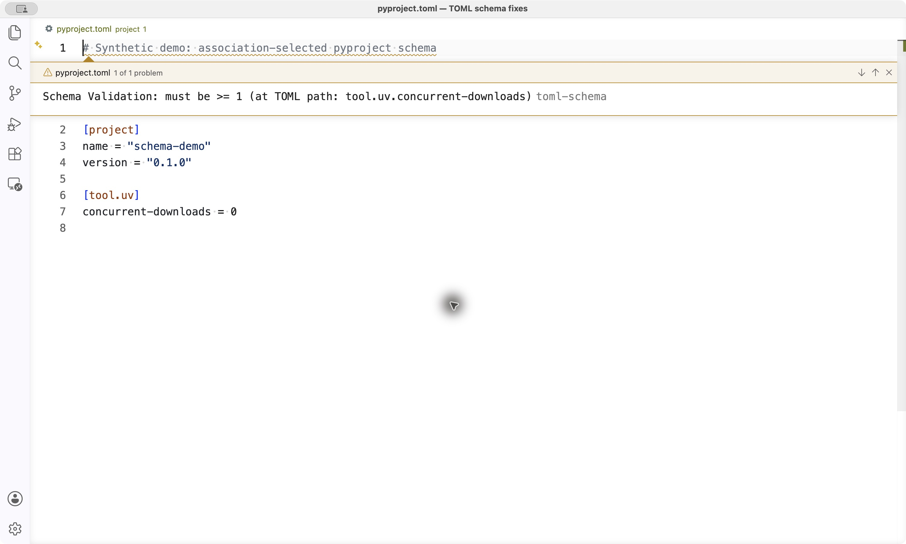
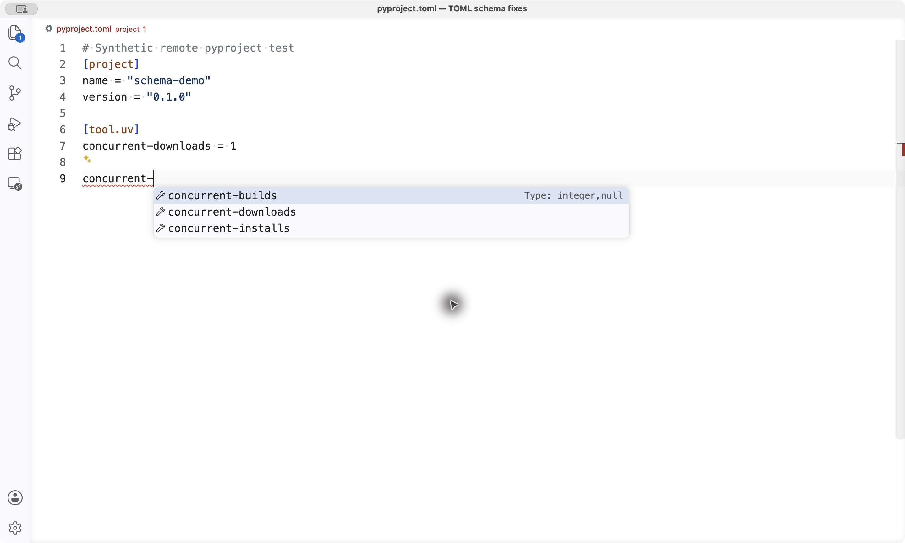
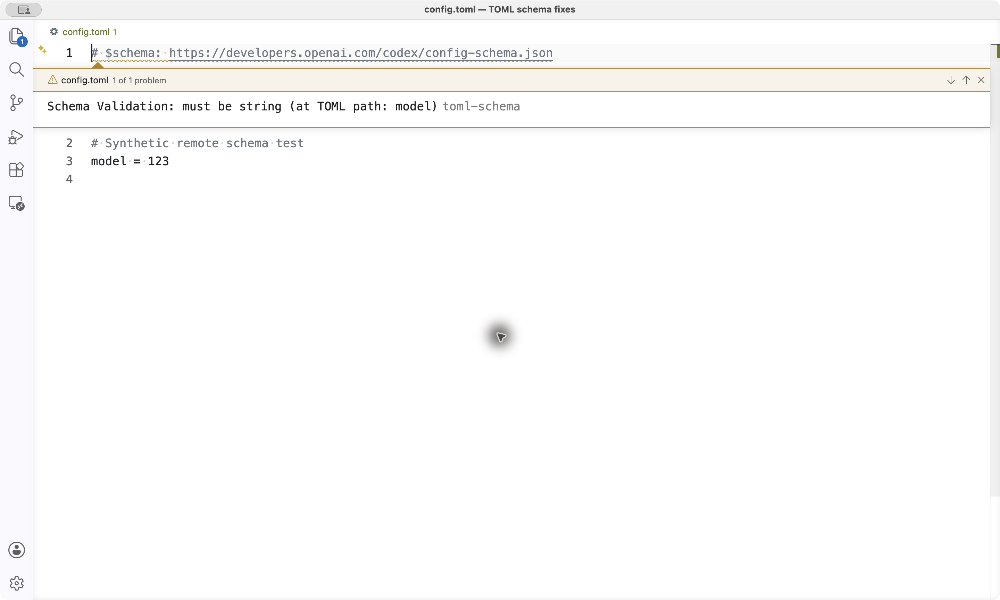
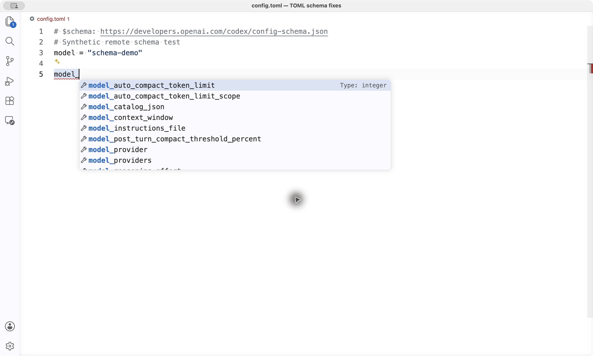
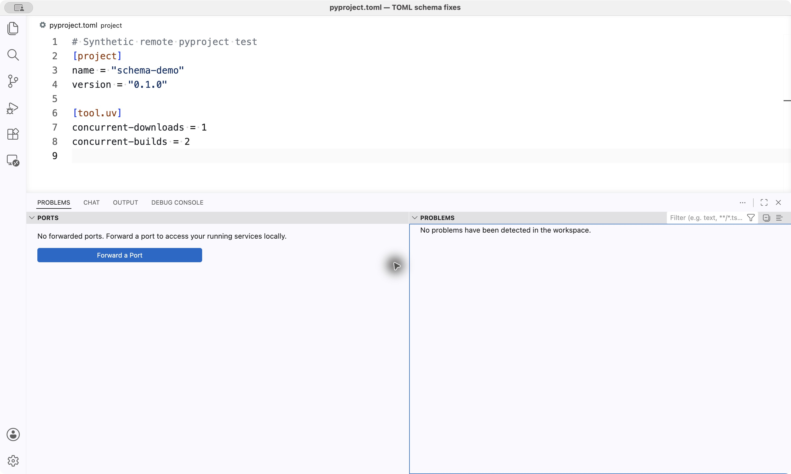

# Installed schema-fixes proof — October 8, 2026

Both fixes were tested together and then installed as a temporary **0.4.3 VSIX**, replacing the official 0.4.2 extension locally and in a Linux Remote-SSH window. Interactive checks passed in both environments using synthetic files.

Installed source: [`45746088f07c24149467ac4a10cf769235469f7d`](https://github.com/justinTM/toml_hilighter/tree/45746088f07c24149467ac4a10cf769235469f7d). VS Code: **1.124.2**; local regression host: macOS arm64. Local and remote installed `extension.js` matched the fork source (SHA-256 `90ac52afc1180d88768199aa5b7248396d52fe9a078fd74d03cf97574c75a268`).

| Check | Observed result |
| --- | --- |
| [Glob fix, PR #10](https://github.com/ParisNeo/toml_hilighter/pull/10) | `**/pyproject.toml` and bare `pyproject.toml` pass regression cases; installed pyproject association restores uv constraint warnings and key completion. |
| [Format fix, PR #11](https://github.com/ParisNeo/toml_hilighter/pull/11) | Live Codex/uv schemas containing `uint` formats load; invalid types/bounds produce warnings and schema properties appear in completion. |
| Corrected values | Changing uv concurrency from `0` to `1` and Codex `model` from `123` to a string clears the warnings; Problems is empty. |
| Combined regressions | **25/25 passed**: 14 association cases, 9 format/constraint cases, and 2 live-schema cases. Supported `email`, `uri`, and `int32` formats remain validated. [Extracted results](regression-results.txt). |

Against the original code, the first association case failed with “No schema association found”; the first format case failed after Ajv rejected `uint`. Each PR also has its separate regression suite. The 25-case combined run preceded package version/provenance changes; the screenshots below verify the subsequently installed 0.4.3 VSIX.

Reproduce the combined regression run from the tested commit:

```sh
npm ci
TOML_TEST_LIVE_SCHEMAS=1 npm test
```

The runner uses an isolated VS Code profile/workspace. Live checks require network access and use the schemas published at run time.

## Screenshots from the installed Remote-SSH build

Even Better TOML was disabled in the proof windows and word-based suggestions were off. Diagnostics identify `toml-schema`. All images are original captures containing synthetic data only. Incomplete key prefixes temporarily show syntax errors while requesting completion.

**Pyproject validation and completion:**





**Codex validation and completion:**





**After correcting the values:**



The [pyproject wrapper used in the proof](pyproject-uv.schema.json) nests a public uv schema snapshot under `[tool.uv]`; it validates uv settings only. The original GitHub `/blob/` URL serves HTML, and raw `uv.schema.json` alone describes top-level `uv.toml`, so neither is a full pyproject schema. This configuration correction is separate from the glob and format bugs.

These are dated installation results, not a claim of four days of continuous use or testing on every platform. The two upstream PRs remain independently reviewable; this evidence lives only on the combined fork branch.
